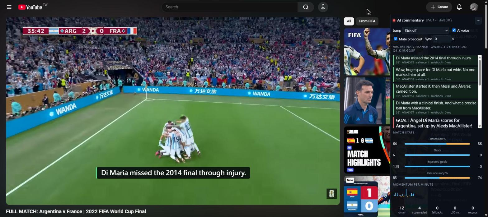
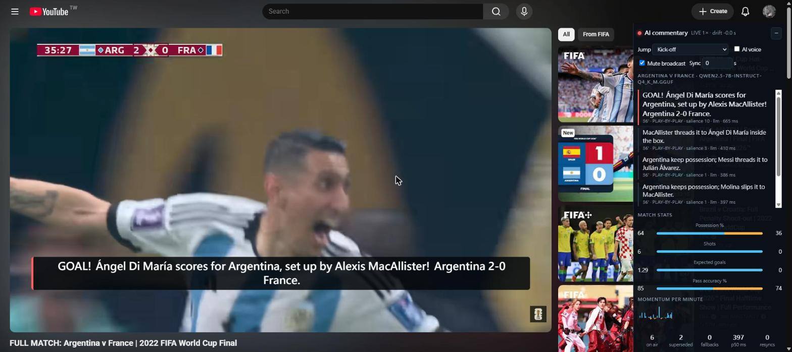
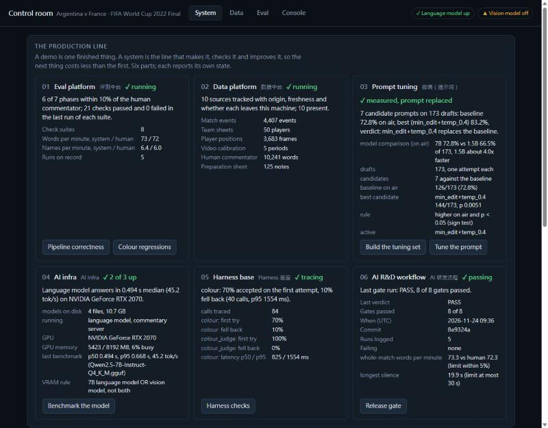
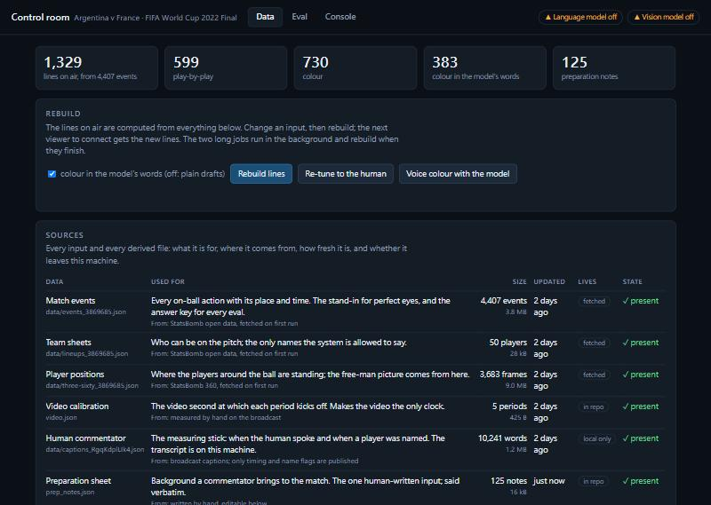
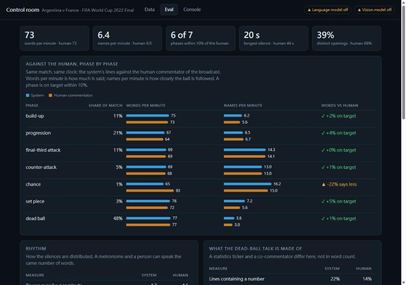
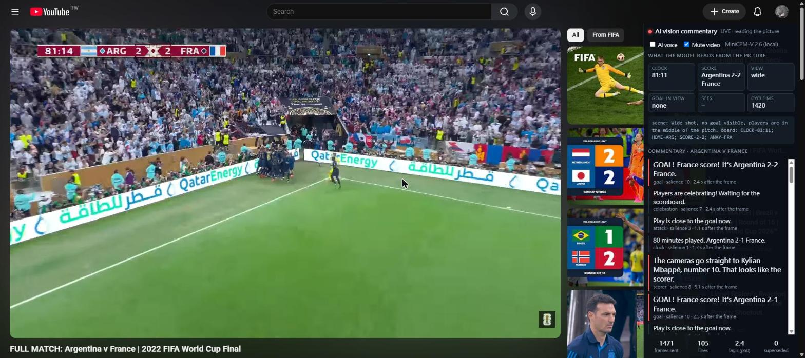

# Live Football Commentary & Analysis on the real broadcast — zero-cost reference build

AI play-by-play, a tactical analyst, live stats and spoken audio, **overlaid on the real match footage on YouTube**
and kept in sync with the picture. Commentary is written by a **local open LLM** behind a guardrail.
No paid services: Python stdlib, Chrome, one open model on the GPU.

## Demo

[](demo/demo.mp4)

A two-minute clip, `demo/demo.mp4`. It shows 34:18 to 36:24 of the match (the build-up, Argentina's second goal, the replay
talk): the system's captions and voices over the muted broadcast picture.

How the clip was made: `demo/record.js` runs in the YouTube tab and draws only the video frame and the caption onto a
canvas, then records that canvas. A caption appears when the video's own clock reaches the line's time, as in the live
overlay. A screen recorder would also have captured the browser and the account. The recording is handed to a local
receiver tab opened on a click (`python demo/record_demo.py receive`), because a youtube.com page may not post to
localhost without a browser permission and an automated tab may not download. Browser speech cannot be recorded, so the
voices in the clip are rendered ahead of time with the Windows voices (David for play-by-play, Zira for the co-commentator)
and laid on the sound track by `python demo/record_demo.py mux` at the same times with the same cut-in rule. The live
overlay uses the browser's own voices. The broadcast is not downloaded and its own audio is muted.



## The system: a production line and what comes off it



A single demo is one finished thing. What makes this a system is the line that makes it, checks it and improves it, so
that the next product costs less than the first. The dashboard's System room (`http://localhost:8765/dashboard`) shows each
part of the line reporting its own state.

**The production line**

| Part | What it is here | Evidence |
|---|---|---|
| Eval platform | The scorecard against the human commentator and the check suites (`eval.py` 16 checks, `eval_colour.py` 5, `eval_harness.py` 15, `eval_products.py` 23), run from the Eval room; history in `runs/control.jsonl`. | `python eval.py`; the gate reads the scorecard at 73.3 words per minute against the human's 72.3 |
| Data platform | The Data room: every input and derived file with its origin, freshness and whether it leaves the machine; the rebuild levers; the preparation sheet. | The Data room table above (10 rows) |
| Prompt tuning | `tuning/`: the prompt of the colour re-voicing call is chosen the way the booth's knobs are, by measurement. Each candidate changes one thing and states the failure it is aimed at; all are run on the same 173 drafts, one attempt each, and a rewrite counts only if it passes the lexical checks and the same-meaning judge and is not a copy of the draft. A candidate replaces the baseline only if it puts more lines on air with p < 0.05 on a paired sign test. No model weights are trained: fine-tuning was considered and dropped as too much compute for the gain. | Baseline 126 of 173 on air (72.8%). No single change qualified (best: "change as few words as needed", 139, p 0.066). The two best combined, that instruction plus temperature 0.4, reached 144 (83.2%), p 0.005, and is now active (`tuning/prompts.json`). Because it was picked after looking, it was re-tested on 99 drafts it was not chosen on, the ones the baseline had failed three times: 21 on air against 11, p 0.013 (`python tuning/confirm.py`). Same set, model choice: the 7B puts 72.8% on air, the untuned 1.5B 66.5% at about a quarter of the latency. Limits: the judge is the same 7B; lines already in the cache were voiced with the old prompt. |
| AI infra | `infra.py`: model registry (the 1.5B and 7B language models, the vision model and its projector), a routing table that says which call uses which model and why, service checks, GPU state and a benchmark. The GPU has 8 GB, which holds the 7B language model or the vision model, not both. | `python infra.py`: RTX 2070, 5420 of 8192 MB in use with the 7B model up; last benchmark in `runs/bench.jsonl`: 8 calls, p50 0.494 s, p95 0.668 s, 45.2 tokens per second |
| Harness base | `harness.py`: every model call goes through one function that owns the HTTP call, the timeout, the retries, the check loop, the fallback and one trace line per call (`runs/traces.jsonl`). | `harness.status()`: 84 calls traced; colour lines 70% accepted on the first attempt, 10% fell back (40 calls, p50 825 ms, p95 1554 ms); the meaning judge 44 calls, 0% fell back |
| AI R&D workflow | `gate.py`, the release gate: the two suites plus six thresholds on the scorecard. The same command runs in CI (`.github/workflows/eval.yml`, on push and pull request to `main`). Every run is logged to `runs/gates.jsonl`. | `python gate.py`: 8 of 8 gates passed (eval.py checks 16 pass; eval_colour.py checks 5 pass; words per minute 73.3 vs 72.3; names per minute 6.38 vs 5.98; phases within 10% 6 of 7; longest silence 19.9 s; pauses over 10 s per minute 1.09 vs 0.72; colour lines containing a number 22%) |

The GitHub Actions run itself has not been observed yet: the workflow file exists and runs the same command, but it has not
been seen to execute on GitHub. The gate was run locally only.

**What comes off the line**

| Product | What it is | Output |
|---|---|---|
| Live commentary overlay | The first product: the booth's lines drawn on the real broadcast and spoken, as described above. | `demo/demo.mp4` |
| Match report and three social posts | A headline, a summary, a numbers table, then a single post, a five-post thread and a caption; every figure is read from the events. | `samples/report.md` (397 words) |
| Player report card | One rating per player from a stated formula (6.0 plus weights on goals, xG, chances created, ball wins, dribbles, saves, pass accuracy, minus fouls and losses of the ball). The formula ignores minutes played and goals conceded, so a short appearance and a full match are scored alike and a goalkeeper is not penalised for the goals he let in. | `samples/ratings.md` (34 players rated) |
| Asset library | One accent-insensitive search over the lines on air, the preparation notes and the highlight moments, each result with a link to the video second. | `python products.py search "Di Maria"`; the System room |
| Highlights edit list and subtitle track | An edit list of video clips with YouTube deep links, and a WebVTT subtitle track of the system's commentary on the video's own clock. No video is downloaded or cut. Nobody has yet played the subtitle track against the video. | `samples/highlights.md` (8 highlights), `samples/commentary.vtt` (1328 cues) |

**Why these and not others.** Every product reuses what the commentary already needed: the event data, the lines on air and
the guardrail idea of text that is true by construction. None of them calls a model, which is why each could be built and
checked in minutes. A product that needs a model would go through the same harness and the same gate.

## Run it

```
start_demo.cmd
```

This starts the local LLM (`start_llm.cmd`, port 8081), the commentary server (`python server.py`, port 8765) and opens
the FIFA full-match video on YouTube. Then load the overlay on that tab, one of:

- **Extension (once):** `chrome://extensions` → Developer mode → Load unpacked → the `extension/` folder.
- **No install:** F12 → Console → paste → Enter. `start_demo.cmd` already put the loader on the clipboard
  (it is the one line in `console-snippet.txt`).

The first time, Chrome asks whether youtube.com may connect to apps on this device → **Allow** (it talks to
`localhost:8765` only). `http://localhost:8765/dashboard` is the control room (see below). Press play, or pick a goal in **Jump**. Pause, seek or change speed in the YouTube player:
the commentary follows.

`python eval.py` — 16 deterministic checks in ~1 s. `python eval.py --llm` — the same plus 86 real jobs through the LLM.
Without the LLM server the template commentator runs. Any OpenAI-compatible endpoint works instead of the local model:
`set LLM_BASE_URL=https://api.openai.com/v1`, `set LLM_MODEL=...`, `set LLM_API_KEY=...`.

Production line and products: `python gate.py` (release gate), `python infra.py` (models, routing, services, GPU),
`python products.py all` (report, ratings, highlights, subtitle track).

## The booth: ball-first rules, tuned to a human commentator

`game.py` is the football model (ball live or dead → possession → where → phase of play → who is free around the ball).
`booth.py` puts two voices on one microphone on top of it: play-by-play follows the ball, colour talks when the ball is dead
or far from goal. How often each speaks in each phase is not hand-set: `python booth.py` runs a loop that replays the match,
compares the booth with the human commentator of the same broadcast (captions, `data/captions_RgqKdplLIk4.json`) phase by
phase, nudges the knobs of that phase, and repeats. The result is saved in `booth_params.json` and used by `server.py`.


| Phase (share of match) | words/min booth · human | names/min booth · human |
|---|---|---|
| dead ball (48%) | 77 · 77 | 3.6 · 3.0 |
| progression (21%) | 67 · 64 | 6.5 · 6.7 |
| build-up (11%) | 75 · 73 | 6.2 · 5.6 |
| final-third attack (11%) | 69 · 69 | 14.3 · 14.1 |
| counter-attack (5%) | 69 · 68 | 13.0 · 13.0 |
| set piece (3%) | 76 · 72 | 7.2 · 5.6 |
| chance (1%) | 65 · 83 | 16.2 · 15.0 |
| **whole match** | **73 · 72** | **6.4 · 6.0** |

| Rhythm | booth | human |
|---|---|---|
| pauses over 3 s, per minute | 4.7 | 4.1 |
| pauses over 10 s, per minute | 1.09 | 0.72 |
| 99th-percentile pause | 10.2 s | 10.1 s |
| longest pause | 19.9 s | 46.0 s |

| What the dead-ball talk is made of | booth | human |
|---|---|---|
| lines containing a number | 22% | 14% |
| lines naming a player | 30% | 25% |
| distinct two-word openings | 39% | 88% |
| words per line | 11.5 | 8.5 |

Colour comes in pairs of sentences followed by a breath (`booth.RUNS`); of six patterns tried, pairs came closest to the
human's pause distribution, and a goal or a penalty is talked through without a breath. Measured in Chrome on the real video,
35:15 to 37:13 (the second goal and its replay): 18 of 18 lines spoken, the goal call started 1 s after the goal, the voice
was speaking 40% of the time, longest silence 10.5 s, speech started a median 110 ms after the line arrived.
Play-by-play says where and how as well as who ("Di María, wide on the left", "Molina, back to De Paul", "Hernández goes past
Fernandez"), and the browser voices are two different people with measured timing (`booth.speak_time`).

**What the colour voice says** (`colour.py`). Measured on the broadcast, a human's dead-ball talk is not statistics: 14% of
the utterances contain a number. It is mostly the replay. So colour is built, in this order of preference, from:

1. the replay: how the passage ended and what led up to it (who overhit the pass, who had won it back, which foot the shot
   came off and from where), all of it from events the play-by-play had no time to say;
2. a verdict on the incident (a big chance, a tactical foul, a free kick in shooting range);
3. the pattern of the current possession (one side hunting the ball, the other going back to the goalkeeper);
4. a reading of the match, said as a conclusion (who cannot get out, where the joy is);
5. background from the preparation sheet (`prep_notes.json`, 125 notes and the two coaches), rationed across the match and
   spent freely only in long stoppages;
6. the stakes and the clock.

Nothing repeats to fill time: the same sentence cannot return inside five minutes, the same reading inside fifteen, and
five ways of saying one side is on top count as one point. Adding that rule dropped the booth from 74 to 56 words a minute,
which is how much of the earlier density had been repetition; items 1 and 3 and a larger preparation sheet brought it back.

**The model writes, three checks decide** (`colour.Writer`, `python booth.py --write`). Every colour line is a plain draft
that is true by construction. A language model re-voices it; the rewrite goes on air only if (a) the lexical guardrail finds
no new name, number or event, (b) a second, one-word call to the model judges it to mean the same as the draft, and (c) it
does not open like any of the last thirty lines. Three attempts, then the draft. Audited by hand on 299 rewrites before (b)
existed: about one in seven had changed the meaning without adding a single new word the guardrail could catch ("keep
getting caught offside" became "struggling to defend offside traps"); the judge catches roughly half of those. Rewrites are
cached in `data/colour_cache.json`, so the replay server never waits on the model.

Final pass over the whole match: 1,329 lines on air, 730 of them colour. About 215 are preparation notes and go out as
written (rewording them is where the model did most of its damage: "scored twice and twice" became "four goals in this
tournament"). Of the 516 sent to the model, 383 (74%) are on air in the model's words and 133 as the plain draft. A hand
read of 47 rewrites before notes were made verbatim found 4 wrong, all of them notes.

`python eval_colour.py` holds five regressions, each one a mistake found by reading the booth next to the human transcript
(a substituted player called quiet "so far", "a grip on this final" for a side still behind, a stale verdict after a goal,
the score read out every minute, one sentence three times in two minutes).

Limits: tuned and scored on the same single match and commentator, so it is not yet validated elsewhere. Density, silence
and what the talk is about now match; eloquence does not. The human tells the story of the night ("they had a hand on the
trophy"); the booth says correct, relevant, plain things, and how well they are put is capped by the local 7B model. Openings
are still far less varied than the human's. The voice is browser speech synthesis (two different voices, measured timing),
recognisably synthetic. The server replays lines computed ahead of time; on a live event feed the same `Booth.feed` runs
event by event, but the model would have to voice colour lines a few seconds ahead, which is not built. The shootout still
uses the older Director.

## The control room: data and eval

`http://localhost:8765/dashboard` has two rooms, Data and Eval. Both read the same booth run that viewers get.



**Data room**

| Data | Used for | Comes from | Fresh | Leaves the machine |
|---|---|---|---|---|
| Match events (`events_<id>.json`) | every on-ball action; the answer key for the evals | StatsBomb open data | fetched on first run | fetched |
| Team sheets (`lineups_<id>.json`) | who can be on the pitch; the only names the system may say | StatsBomb open data | fetched on first run | fetched |
| Player positions (`three-sixty_<id>.json`) | where the players around the ball stand (the free-man picture) | StatsBomb 360 | fetched on first run | fetched |
| Video calibration (`video.json`) | the video second at which each period kicks off | measured by hand on the broadcast | when edited | in repo |
| Human commentator | the measuring stick: when the human spoke, when a player was named | broadcast captions; the transcript if it is on the machine, else `data/human_timing.json` | when exported | local only (transcript) or in repo (timing) |
| Preparation sheet (`prep_notes.json`) | background said verbatim | written by hand | when edited | in repo |
| Tuned knobs (`booth_params.json`) | how often each voice speaks in each phase | Re-tune to the human | after each re-tune | in repo |
| Model-voiced lines (`data/colour_cache.json`) | colour drafts re-voiced by the model that passed all three checks | Voice colour with the model | after each run | in repo |
| Vision traces (`runs/vision-*.jsonl`) | input to the vision eval | `vision_server.py` | after each vision run | local only |
| Local models (`models/*.gguf`) | the language and vision models | downloaded once | once | local only |

Each row shows the file's size and age. The page also shows whether the language model and the vision model are running.

- **Rebuild lines** runs the booth over the whole match again with the current knobs, notes and cache (about 0.3 s). The next
  viewer to connect gets the new lines. A switch chooses model-voiced colour or plain drafts.
- **Re-tune to the human** and **Voice colour with the model** are background jobs (about 90 s and up to 10 min). Both
  rebuild when they finish; only one job runs at a time.
- **Tuned knobs** are shown read-only on purpose: a hand-set number is a guess, the loop sets them.
- **Preparation sheet**: add or remove notes. A note is checked: `about` must be the match, a team or a player on the team
  sheet, and the text is 3 to 40 words, ending with a full stop. It takes effect on the next rebuild.
- **On air** shows the system's lines in a three-minute window, interleaved with the human commentator's words when the
  transcript is on the machine. Without it only the system is shown.



**Eval room**

- The scorecard against the human commentator, phase by phase: words per minute, names per minute, and whether the phase is
  on target (within 10% of the human on words per minute). Below it, the rhythm and what the dead-ball talk is made of
  (the same measures as the tables above, recomputed from the current lines).
- Check suites (`eval.py`, `eval_colour.py`, `eval_game.py`, `eval_human.py`, `eval_vision.py`, `eval.py --llm`) start from
  the page, one at a time. Results and history are kept in `runs/control.jsonl`. A suite that cannot run here says why: it
  needs the transcript, the language model, or at least one vision run.

**Safety of the control API.** It is served on 127.0.0.1 only. `/api/*` checks the `Host` and `Origin` headers and sends no
CORS header, so the YouTube overlay origin can read `/stream` and `/meta` but not the control room. It accepts JSON bodies
only (small, one object). Jobs come from a fixed list in `control.py`, so nothing a browser sends becomes a command.

Files: `control.py`, `dashboard.html`.

### What is not in the repository

- The broadcast transcript is not redistributed. `data/human_timing.json` (10,241 words: match second and whether the word
  was a player's name) and `data/human_baseline.json` are in the repo. They reproduce the transcript's words per minute and
  names per minute exactly (72.296 and 5.979 either way), so the tuning loop and the scorecard run on a fresh clone.
- `python booth.py --export-human` regenerates both files from a local transcript. `eval_game.py` and `eval_human.py` need the
  transcript itself.
- StatsBomb data is fetched on first run.
- Model weights are not included.

## Vision mode: commentary from the picture alone

A second mode that uses **no event data and no audio**: it looks at the frames of any football video that is playing.

```
start_vision.cmd          local vision model on :8770 (stop start_llm.cmd first: one 8 GB GPU holds one model)
```

Then load the overlay on any YouTube football video: F12 → Console → paste `console-snippet-vision.txt`.



**Inputs**

| Input | Required | Used for |
|---|---|---|
| Frames of the playing video, 1280×720, about 2 per second | yes | everything |
| `vision_match.json`: team names, kit colours, shirt number → name, starting XI, substitutions (minute, off, on) | no | naming players; only players who can be on the pitch at the current scoreboard time are ever named |
| `scoreboard_box` in the same file | no (defaults to top-left) | where to read clock and score |

Without the file the team codes are read off the scoreboard and no player is named.

**Outputs** (SSE, and a JSONL trace in `runs/`)

- Observation per cycle: clock, score, wide/close-up, goal in view, what the model thinks it sees, cycle time, raw model text.
- Commentary line: text, kind, salience, seconds behind the frame it came from.

**Pipeline**: frame → three 448×448 tiles (whole frame, scoreboard crop, close-up crop) → MiniCPM-V 2.6 answers one short
question per tile → Observer (debounce, sanity rules) → the same Director → line. Three registers by measured reliability:
*fact* (scoreboard: stated plainly), *impression* (seen twice: "looks like"), *silence* (never announced).

**Measured** (`python eval_vision.py`; the event data of the same match is the answer key, the pipeline never sees it)

| What | Result |
|---|---|
| Scoreboard score read correctly | 56/56 (159/160 in an earlier 6-minute run) |
| Scoreboard clock | median 1.4 s behind, within 3 s in 52/56 readings |
| Goals announced with the right team and score | 3/3, no false goal calls, median 8.2 s after the shot |
| "Looks like the scorer" (close-up + shirt number + lineup) | 2/2 |
| Player named from a close-up was on the ball within ±25 s | 3/3 with the on-pitch rule; 19/40 before it |
| "Play is close to the goal" was true | 4/6 (10/16 earlier) |
| Corner claims that were real corners | 0/1 (1/2 earlier): unreliable |
| Wide shot vs close-up, 30 labelled frames | 29/30 |
| Analysis cycle | p50 1.4 s, p95 2.5 s; lines land 1–2.5 s after the frame |

Sample: 3.6 minutes of this match after the last rule change, so treat the small counts as indications.
On a match with no configuration at all (Brazil v Norway 2026, different graphics) it read `BRA 0-1 NOR` and the clock unaided.

**What it cannot do**

- No pass-by-pass commentary, no "who has the ball": players are a few dozen pixels in a wide shot and a general 8B vision
  model cannot track them. That needs dedicated player/ball detection and tracking.
- A goal is only called when the scoreboard changes (about 8 s late). Celebrations alone are not trusted.
- Free kicks, throw-ins and goal kicks are never announced: the model claimed "free kick" in 16 of 62 open-play cycles.
- Tried and dropped: full-resolution frames (8–22 s per frame), a fill-in-the-form prompt (same answer for every frame),
  naming the teams in the scene question (the model stopped describing the action).
- Vision mode speaks template lines: the GPU cannot hold the vision model and the 7B text model together.

## 1. Problem and constraints

| Requirement | Consequence for the design |
|---|---|
| Commentary must match the real picture | The video player owns the clock; everything else follows it. |
| Commentary must feel live | Line on air about 1 s after a goal. Late commentary is worse than silence. |
| A human can only listen to ~1 line every few seconds | Events arrive 0.5/s; **most must be dropped on purpose**. Choosing what to say is the core problem, not generating text. |
| Wrong scorer / wrong score / invented event is unacceptable | The LLM never sees raw data and is never trusted: facts contract, verified draft, guardrail, fallback. |
| Free only, and legal | Open event data, the official video played in place on youtube.com (not copied), open model, browser speech. |
| Must not die on stage | Every dependency has a deterministic fallback: no LLM → template, no video → data console. |

## 2. Architecture

```
 Real broadcast (YouTube <video>)                       StatsBomb open event data (4,407 events)
        | currentTime, rate, paused, ad                         |
        v                                                       v
 Overlay (extension/overlay.js)                          Match (source adapter)
   video time --> match time  (video.json: the video         |
   second at which each period kicks off)                    v
        |  GET /stream?t=<match time>&speed=<rate>       State reducer --> stats / xG / momentum
        |  reconnect when drift > 1.5 s (seek, stall)        |
        v                                                    v
   <------------------- SSE ----------------------       describe()  event -> {kind, salience 0-10, facts}
   state -> side panel (stats, momentum, health)             |                    ^ the facts contract
   line  -> lower-third caption ON the real picture          v
            + browser speech (broadcast audio muted)    Director   airtime budget in wall-clock seconds
                                                          - salience >= 7 -> speak now, pre-empt
                                                          - else best event since the last line waits for a 4 s slot
                                                          - queued > 6 s -> dropped (stale)
                                                          - analyst slot every 5 match-minutes, after goals/breaks
                                                             | job
                                                             v
                                                        Commentator (worker thread, off the replay path)
                                                          draft = template(facts)            deterministic, always true
                                                          LLM restyles the draft (2.5 s timeout)   local Qwen2.5-7B
                                                          guardrail(text, facts, draft) -> on air, else the draft
```

**The video is the clock.** The server never decides what time it is; the player does. That is what makes pause,
seek, 2× speed and ads work, and it is the same contract a production system has with a broadcast feed.

Files: `engine.py` (pure pipeline), `server.py` (SSE API), `extension/overlay.js` (YouTube overlay), `video.json`
(video ↔ match-clock calibration), `llm_server.py` (local model, OpenAI-compatible), `eval.py`, `index.html`
(data-only console).

## 3. Design decisions and trade-offs

1. **Overlay on the real page instead of embedding or downloading.** FIFA blocks embedding of this video on other sites
   (YouTube error 150), and downloading it would break YouTube's terms. A script on youtube.com reads the real
   `<video>` clock and draws on top of the real picture; nothing is copied.
2. **Sync by calibration, verified on frames.** `video.json` holds the video second at which each period kicks off, read
   from the on-screen match clock. Checked against real frames: Messi's penalty is struck at video 1438.6 s and the
   line lands at 1439.1 s; Di María's goal line lands while the broadcast scoreboard still shows 1-0. Event timestamps
   in the data are themselves 0.5–2 s behind the picture, so commentary trails the action slightly, like a human
   commentator. A `Sync` field nudges the offset. Upgrade path: OCR the on-screen clock to self-calibrate.
3. **Facts contract.** `describe()` turns each raw event into a small JSON of verified facts (player, team, xG, keeper,
   assist; the score only for score-changing events). Nothing else reaches the template or the LLM.
4. **Salience before generation.** A deterministic scorer ranks events (goal 10, post 8, save 7, card 6, shot 5,
   corner 4, pass 1). Cheap, explainable, testable. Trade-off: hand-tuned weights; upgrade is to learn them from real
   broadcast transcripts.
5. **Airtime budget in wall-clock time.** The Director budgets what a listener can absorb, so it behaves the same at
   1× or 8×. At 8×, 4,407 events become 197 lines; 665 lower-value candidates are superseded on purpose.
6. **The LLM restyles a verified draft; it does not write from data.** First version: facts JSON in, sentence out. A
   real 1.5B model then produced fluent lies that passed the name/number check ("Lloris saves Giroud" for a pass,
   "in a penalty shootout" for a first-half goal). Fix: the template line is the draft, the model only changes the
   wording, and the guardrail gained two checks. Result: 93–95% of LLM lines on air, the rest fall back to the draft.
7. **Guardrail = four deterministic checks**, each named in the fallback reason shown in the panel:
   `name` (player/team of this match not in the facts), `number` (not in the facts), `proper` (capitalised word not in
   the facts — names from outside the match), `claim` (event word such as goal, save, foul, lead that neither facts nor
   draft assert). Lexical, fast (<1 ms), explainable; it cannot judge tone.
8. **Two voices, two latency tiers.** Play-by-play: one sentence. Analyst: stats snapshot, double slot. In production
   these map to a small fast model and a larger one.
9. **Generation off the hot path.** The replay thread never waits for the LLM. An ordinary line that comes back after
   it is stale is dropped; critical lines (salience ≥ 7) are always delivered.
10. **SSE, not WebSocket.** One-way server → client over plain HTTP. The overlay reconnects with a new `t` on every
    seek, which makes the stream stateless and the server trivially restartable.
11. **Browser speech synthesis.** Free. Big moments cancel the current utterance; ordinary lines never queue behind
    speech (caption only), so audio cannot drift behind the match.

## 4. Evaluation

`python eval.py` (deterministic, template commentator):

| Check | Result |
|---|---|
| Final score from the reducer equals ground truth from match metadata; shootout tally | 3-3 and 4-2, pass |
| Every goal has a line, at the moment it happens, naming the scorer | 6/6 |
| Every emitted line passes the guardrail | 197/197 |
| Guardrail rejects: wrong scorer, invented number, outside name, wrong event verb, invented outcome | 5/5 |
| Guardrail accepts a faithful paraphrase | pass |
| Airtime budget: ordinary lines ≥ 4 s apart | min gap 4.00 s |
| LLM path vs scripted mock: faithful → used; hallucination, timeout, HTTP 500 → draft | pass |

`python eval.py --llm` (real model, 86 jobs, RTX 2070):

| Model | On air | Fell back (reason) | p50 | p95 |
|---|---|---|---|---|
| Qwen2.5-1.5B-Instruct Q4 | 80/86 (93%) | 5 claim, 1 proper | 215 ms | 502 ms |
| Qwen2.5-7B-Instruct Q4 | 82/86 (95%) | 3 claim, 1 proper | 335 ms | 724 ms |
| 1.5B with the first prompt (facts in, no draft) and the 2-check guardrail | 20/30 passed, most of those factually wrong | — | 388 ms | 644 ms |

Verified by hand in Chrome on the real video: sync at two goals (+0.5 s penalty, about +1 s with the LLM), pause and
2× speed, speech start/end/interrupt events, overlay loaded through the console loader.

Not yet measured: commentary *quality* (excitement, variety, insight). Next step is an LLM-judge rubric calibrated on
human-labelled samples, and comparison with real broadcast transcripts.

## 5. Path to production (what changes for a real customer)

| Demo | Production |
|---|---|
| Recorded match, open event data | Licensed live event feed (or tracking / vision); message bus between stages |
| Clock from the YouTube player, hand-calibrated offsets | Broadcast timecode from the rights holder, or OCR of the on-screen clock |
| One pipeline per viewer | **One pipeline per match per language**, fan-out by pub/sub/CDN — LLM cost is independent of audience size |
| Local 7B model | Small fast hosted model for play-by-play, larger model for the analyst; structured outputs for the facts contract |
| Browser TTS, captions drawn client-side | Streaming TTS / realtime voice model, audio mixed and delayed to match the video delay |
| Lexical guardrail | Same checks online + offline NLI/LLM-judge on sampled traces, human review of failures |
| Panel counters | Tracing per line: event → facts → draft → output → guardrail verdict → latency; replay of any failed trace |
| Hand-tuned salience | Weights learned from broadcast transcripts; per-customer tone and house style in the prompt |

Rough volume at 1×: ~800 lines per match, ~250 input + 30 output tokens each → about 0.25M tokens per match per language.

Reusable across customers: source-adapter interface, clock contract, facts contract, Director, guardrail, eval harness.
Bespoke per customer: data feed adapter, salience weights, voice/tone, languages, compliance rules (injuries, betting).

## 6. Known limits (honest list)

- **This is a recorded match with open event data.** A match that is live right now has no free event feed; the same
  pipeline needs a licensed live feed (or a tracking/vision system) in place of `Match`. Commentary is generated from
  event data, not from understanding the pixels.
- Sync is calibrated once per video per period (5 numbers). Accuracy is about ±1 s, limited by the event timestamps.
- The overlay must be loaded into a signed-in Chrome by the extension or the console loader. A fresh automated Chrome
  profile is not an option: YouTube answers it with a bot check, and Chrome no longer loads extensions from the
  command line. The console loader was tested; loading as an unpacked extension was not.
- The guardrail is lexical. It rejects some harmless lines ("French", nicknames) and cannot judge tone or emphasis.
- Template wording is repetitive; the LLM mostly restyles one sentence at a time and has no memory of earlier lines.
- YouTube ads pause the commentary. Spoken audio depends on the voices installed in the browser.

## 7. Five-minute demo script

1. YouTube page, **Jump → 36' Di María**. Real footage plays; LLM captions land on the picture with `llm · ~400 ms`;
   the goal line arrives while the broadcast scoreboard still shows 1-0.
2. Drag the YouTube seek bar and switch to 2×: drift returns to 0.0 s — the video is the clock.
3. Point at **superseded** and **fallbacks**: "the system chooses what *not* to say, and the model is never trusted".
4. **Jump → 80' Mbappé**: two goals in 95 seconds — pre-emption, momentum chart flipping.
5. Terminal: `python eval.py --llm` — ground truth, coverage, guardrail tests, real-model latency and verdicts.
6. Tell the guardrail story (decision 6), then close with section 5.

Data: [StatsBomb Open Data](https://github.com/statsbomb/open-data) — free for research with attribution.
Video: [FIFA official YouTube channel](https://www.youtube.com/watch?v=RgqKdplLIk4), played in place on youtube.com; not copied or redistributed.
Model: [Qwen2.5-7B-Instruct](https://huggingface.co/Qwen/Qwen2.5-7B-Instruct) (Apache-2.0), GGUF build by bartowski, run with llama.cpp.
